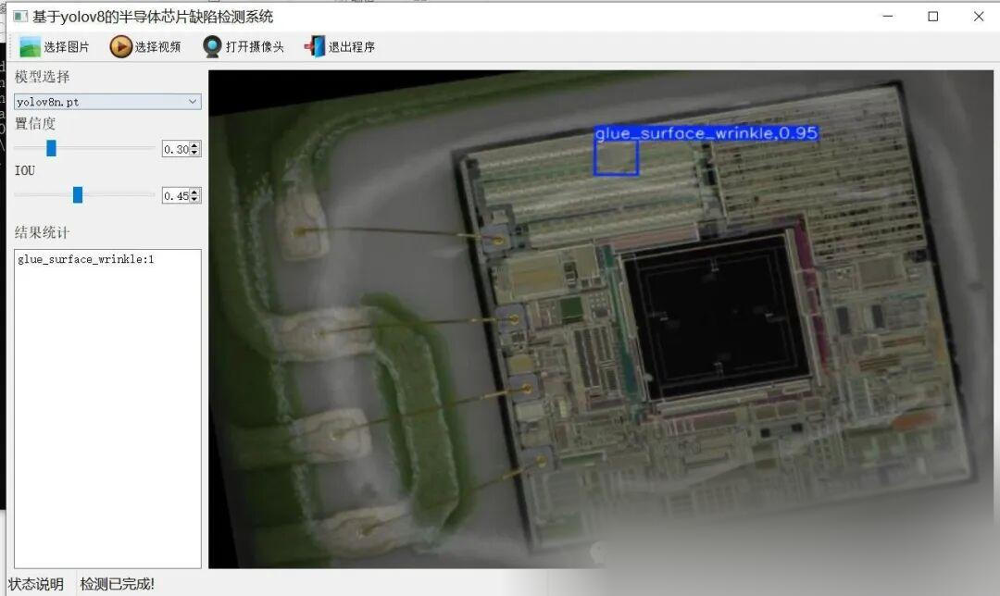
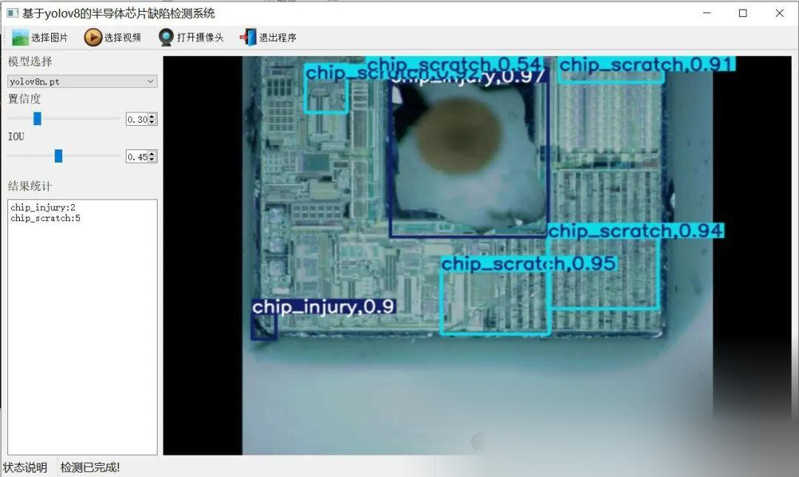

# Semiconductor Chip Defect Detection System Based on Yolov8 in Python Source Code + PyTorch Model + Evaluation Indicator Curve + High-quality GUI Interface

[Algorithm Introduction]

A semiconductor chip defect detection system based on YOLOv8 is an efficient and accurate automated solution specifically designed for the semiconductor manufacturing industry. It is used to detect various defects during the chip manufacturing process. This system utilizes the YOLOv8 deep learning model in conjunction with advanced image processing technology to enable real-time identification and classification of defects on the chip surface, including glue surface wrinkles (glue_surface_wrinkle), chip scratches (chip_scratch), aluminum wire bonding breakage (aluminum_wire_bonding_broken), gold wire bonding breakage (gold_wire_bonding_broken), and chip damage (chip_injury).

YOLOv8, as one of the leading object detection algorithms currently, is renowned for its high accuracy and real-time performance. In the field of semiconductor chip defect detection, YOLOv8 can accurately capture the tiny and complex defect features through multi-scale feature extraction and network structure optimization, achieving efficient and reliable detection.

Furthermore, the system also integrates a user-friendly interface where users can upload chip images through the interface. The system will automatically perform defect detection and display the results of the inspection. This intuitive operation not only enhances the usability of the system but also makes the inspection process more efficient and humanized.

In summary, the semiconductor chip defect detection system based on YOLOv8 provides a high-efficiency and accurate automated detection solution for the semiconductor manufacturing industry. It helps to improve product quality and production efficiency, reduce production costs, and has important application value.

[Effect Display]



 

[Test Environment]

windows10
anaconda3+python3.8
torch==2.3.0
ultralytics==8.3.79

The model can detect the category.

Surface wrinkles (glue_surface_wrinkle), chip scratches (chip_scratch), aluminum wire bonding breakage (aluminum_wire_bonding_broken), gold wire bonding breakage (gold_wire_bonding_broken), and chip damage (chip_injury)

[Training Information]

|

Parameters

 ||

Value

 |
|

Number of training set images

 ||

5286

 |
|

Number of images in the validation set

 ||

588

 |
|

Training map

 ||

99.5%

 |
|

Training Accuracy

 ||

99.7%

 |
|

Training recall rate

 ||

99.4%

 |

###### Validation set test accuracy information

|

Class

 ||

Images

 ||

Instances

 ||

P

 ||

R

 ||

mAP50

 ||

mAP50-95

 |
|

all

 ||

588

 ||

2387

 ||

0.997

 ||

0.994

 ||

0.995

 ||

0.951

 |
|

glue_surface_wrinkle

 ||

253

 ||

750

 ||

1

 ||

0.992

 ||

0.995

 ||

0.917

 |
|

chip_scratch

 ||

218

 ||

496

 ||

0.998

 ||

0.991

 ||

0.994

 ||

0.955

 |
|

aluminum_wire_bonding_broken

 ||

104

 ||

120

 ||

0.991

 ||

1

 ||

0.995

 ||

0.99

 |
|

gold_wire_bonding_broken

 ||

171

 ||

611

 ||

0.999

 ||

1

 ||

0.995

 ||

0.972

 |
|

chip_injury

 ||

234

 ||

410

 ||

1

 ||

0.985

 ||

0.995

 ||

0.922

 |

[Partial Implementation Source Code]

-
-
-
-
-
-
-
-
-
-
-
-
-
-
-
-
-
-
-
-
-
-
-
-
-
-
-
-
-
-
-
-
-
-
-
-
-
-
-
-
-
-
-
-
-
-
-
-
-
-
-
-
-
-
-
-
-
-
-
-
-
-
-
-
-
-
-
-
-
-
-
-
-
-
-
-
-
-
-
-
-
-
-
-
-
-
-
-
-
-
-
-
-
-
-
-
-
-
-
-
-
-
-
-
-
-
-
-

```
class Ui_MainWindow(QtWidgets.QMainWindow):    signal = QtCore.pyqtSignal(str, str)
    def setupUi(self):        self.setObjectName("MainWindow")        self.resize(1280, 728)        self.centralwidget = QtWidgets.QWidget(self)        self.centralwidget.setObjectName("centralwidget")
        self.weights_dir = './weights'
        self.picture = QtWidgets.QLabel(self.centralwidget)        self.picture.setGeometry(QtCore.QRect(260, 10, 1010, 630))        self.picture.setStyleSheet("background:black")        self.picture.setObjectName("picture")        self.picture.setScaledContents(True)        self.label_2 = QtWidgets.QLabel(self.centralwidget)        self.label_2.setGeometry(QtCore.QRect(10, 10, 81, 21))        self.label_2.setObjectName("label_2")        self.cb_weights = QtWidgets.QComboBox(self.centralwidget)        self.cb_weights.setGeometry(QtCore.QRect(10, 40, 241, 21))        self.cb_weights.setObjectName("cb_weights")        self.cb_weights.currentIndexChanged.connect(self.cb_weights_changed)
        self.label_3 = QtWidgets.QLabel(self.centralwidget)        self.label_3.setGeometry(QtCore.QRect(10, 70, 72, 21))        self.label_3.setObjectName("label_3")        self.hs_conf = QtWidgets.QSlider(self.centralwidget)        self.hs_conf.setGeometry(QtCore.QRect(10, 100, 181, 22))        self.hs_conf.setProperty("value", 25)        self.hs_conf.setOrientation(QtCore.Qt.Horizontal)        self.hs_conf.setObjectName("hs_conf")        self.hs_conf.valueChanged.connect(self.conf_change)        self.dsb_conf = QtWidgets.QDoubleSpinBox(self.centralwidget)        self.dsb_conf.setGeometry(QtCore.QRect(200, 100, 51, 22))        self.dsb_conf.setMaximum(1.0)        self.dsb_conf.setSingleStep(0.01)        self.dsb_conf.setProperty("value", 0.25)        self.dsb_conf.setObjectName("dsb_conf")        self.dsb_conf.valueChanged.connect(self.dsb_conf_change)        self.dsb_iou = QtWidgets.QDoubleSpinBox(self.centralwidget)        self.dsb_iou.setGeometry(QtCore.QRect(200, 160, 51, 22))        self.dsb_iou.setMaximum(1.0)        self.dsb_iou.setSingleStep(0.01)        self.dsb_iou.setProperty("value", 0.45)        self.dsb_iou.setObjectName("dsb_iou")        self.dsb_iou.valueChanged.connect(self.dsb_iou_change)        self.hs_iou = QtWidgets.QSlider(self.centralwidget)        self.hs_iou.setGeometry(QtCore.QRect(10, 160, 181, 22))        self.hs_iou.setProperty("value", 45)        self.hs_iou.setOrientation(QtCore.Qt.Horizontal)        self.hs_iou.setObjectName("hs_iou")        self.hs_iou.valueChanged.connect(self.iou_change)        self.label_4 = QtWidgets.QLabel(self.centralwidget)        self.label_4.setGeometry(QtCore.QRect(10, 130, 72, 21))        self.label_4.setObjectName("label_4")        self.label_5 = QtWidgets.QLabel(self.centralwidget)        self.label_5.setGeometry(QtCore.QRect(10, 210, 72, 21))        self.label_5.setObjectName("label_5")        self.le_res = QtWidgets.QTextEdit(self.centralwidget)        self.le_res.setGeometry(QtCore.QRect(10, 240, 241, 400))        self.le_res.setObjectName("le_res")        self.setCentralWidget(self.centralwidget)        self.menubar = QtWidgets.QMenuBar(self)        self.menubar.setGeometry(QtCore.QRect(0, 0, 1110, 30))        self.menubar.setObjectName("menubar")        self.setMenuBar(self.menubar)        self.statusbar = QtWidgets.QStatusBar(self)        self.statusbar.setObjectName("statusbar")        self.setStatusBar(self.statusbar)        self.toolBar = QtWidgets.QToolBar(self)        self.toolBar.setToolButtonStyle(QtCore.Qt.ToolButtonTextBesideIcon)        self.toolBar.setObjectName("toolBar")        self.addToolBar(QtCore.Qt.TopToolBarArea, self.toolBar)        self.actionopenpic = QtWidgets.QAction(self)        icon = QtGui.QIcon()        icon.addPixmap(QtGui.QPixmap(":/images/1.png"), QtGui.QIcon.Normal, QtGui.QIcon.Off)        self.actionopenpic.setIcon(icon)        self.actionopenpic.setObjectName("actionopenpic")        self.actionopenpic.triggered.connect(self.open_image)        self.action = QtWidgets.QAction(self)        icon1 = QtGui.QIcon()        icon1.addPixmap(QtGui.QPixmap(":/images/2.png"), QtGui.QIcon.Normal, QtGui.QIcon.Off)        self.action.setIcon(icon1)        self.action.setObjectName("action")        self.action.triggered.connect(self.open_video)        self.action_2 = QtWidgets.QAction(self)        icon2 = QtGui.QIcon()        icon2.addPixmap(QtGui.QPixmap(":/images/3.png"), QtGui.QIcon.Normal, QtGui.QIcon.Off)        self.action_2.setIcon(icon2)        self.action_2.setObjectName("action_2")        self.action_2.triggered.connect(self.open_camera)
        self.actionexit = QtWidgets.QAction(self)        icon3 = QtGui.QIcon()        icon3.addPixmap(QtGui.QPixmap(":/images/4.png"), QtGui.QIcon.Normal, QtGui.QIcon.Off)        self.actionexit.setIcon(icon3)        self.actionexit.setObjectName("actionexit")        self.actionexit.triggered.connect(self.exit)
        self.toolBar.addAction(self.actionopenpic)        self.toolBar.addAction(self.action)        self.toolBar.addAction(self.action_2)        self.toolBar.addAction(self.actionexit)
        self.retranslateUi()        QtCore.QMetaObject.connectSlotsByName(self)        self.init_all()
```

[Usage Steps]

Usage Steps:
1. First, install the YOLOv8 environment according to the official framework and install PyQt5.
2. After switching to the YOLOv8 environment you have installed, switch to the source code directory and execute python main.py to start the interface, and then perform the corresponding operations.

[Provided Files]

Python source code
YOLOv8n.pt model
Training map, P, R curves (in weights\results.png)
Test images (under test_img folder)

Note: No dataset provided.

[Common Evaluation Parameters Introduction]

In the task of object detection, evaluating the performance of a model is crucial. The terms you mentioned are commonly used metrics for assessing the performance of a model. Here are detailed explanations of these terms:

1. **Class**

: 

-

This usually refers to the categories of objects that the model is designed to detect. For example, a model may be trained to detect different categories of objects such as vehicles, pedestrians, or animals.

1. **Images**

: 

-

Represents the number of images in the validation set. The validation set is a dataset used to evaluate model performance, separate from the training set to ensure fairness in evaluation results.

1. **Instances**

: 

-

The total number of target objects in all images. This includes the sum of all category objects, for example, if the validation set contains 100 images, each image has an average of 5 target objects, then Instances is 500.

1. **P (Precision)**

: 

-

Precision is the proportion of actual positive samples predicted by the model. The formula is: Precision = TP / (TP + FP), where TP represents true positives (True Positives) and FP represents false positives (False Positives).

1. **R (Recall)**

: 

-

Recall is the proportion of all true positives correctly predicted by the model. The formula is: Recall = TP / (TP + FN), where FN represents false negatives.

1. **mAP50**

: 

-

Mean Average Precision (mAP) at an IoU threshold of 0.5, where IoU is the metric used to measure the degree of overlap between predicted bounding boxes and ground truth bounding boxes. mAP is a comprehensive metric that considers both precision and recall when evaluating model performance across different recall levels. At an IoU of 0.5, if the overlap between the predicted bounding box and the ground truth bounding box reaches or exceeds 50%, it is considered correct.

1. **mAP50-95**

: 

-

This represents the average accuracy of the model across IoU values ranging from 0.5 to 0.95 (with a step of 0.05). This is a more stringent evaluation criterion, demanding higher overlap between predicted bounding boxes and ground truth boxes. In object detection tasks, higher IoU thresholds mean that models need to be more accurate in their target object localization. The computation of mAP50-95 takes into account multiple IoU thresholds ranging from lenient to strict, thus providing a more comprehensive assessment of the model's performance.

These indicators collectively form an important framework for evaluating the performance of target detection models. By comparing the performance of different models on these indicators, It can be determined which model may be more effective in practical applications.

[Common Issues]

In the training of object detection, if Mean Average Precision (MAP) is low, there may be the following reasons:
Reason one: Underfitting: If the amount of training data is too small, the model may not learn enough features to affect the prediction effect, leading to underfitting, and subsequently causing MAP to be low. Therefore, it is possible to increase the size of the dataset.
Reason two: Small targets: If the dataset contains most small targets, it is likely that MAP will be low because the features of small targets are not obvious, making it difficult for the model to learn them.
Reason three: Mismatched model tuning parameters: For example, if the learning rate is adjusted too high, it may lead to overly rapid learning, resulting in disordered adjustments of model parameters.
Reason four: Overfitting (which is now almost non-existent in models): If the model performs well on training data but poorly on validation or test data, it may be due to overfitting. This is usually because the model has too many parameters and relatively small training data, leading the model to learn noise or specific patterns from the training data, which cannot generalize to new data. Nowadays, target detection models have made great progress in this aspect, with very few cases of overfitting occurring.
Reason five: Different scenarios: If the validation accuracy on the validation set is high, but not good on the test set, it may be due to inconsistencies between the training model's scene images and the test set.

(1) Optimize model structure: Select the appropriate model based on the task and dataset characteristics, and try using different network architectures and components to improve model performance.
(2) Enhance data preprocessing: Properly preprocess and enhance the data, such as data normalization, missing value imputation, data augmentation, etc., to enhance the generalization ability of the model.
(3) Adjust loss function: Try using different loss functions or combining multiple loss functions to optimize model performance.
(4) Optimize training strategy: Adjust hyperparameters like learning rate, batch size, number of training rounds, and use optimization algorithms like learning rate decay, momentum to improve model training effects.
(5) Use pre-trained models: Utilize pre-trained models on large datasets for transfer learning, which can accelerate model convergence and improve performance.
(6) Increase the number of datasets, provide as many scenarios as possible, to enhance the model's generalization ability and strengthen its feature learning capability.
In summary, improving target detection training MAP requires addressing multiple aspects, including optimizing model structure, enhancing data preprocessing, adjusting loss functions, optimizing training strategies, and using pre-trained models.


## Payment

Here is a pay link on Stripe ( https://buy.stripe.com/3cs8yP7sY87d0vu9AB ). Please contact me lonlonago@foxmail.com after funding $89, and I will send you a complete data files , thank you!


